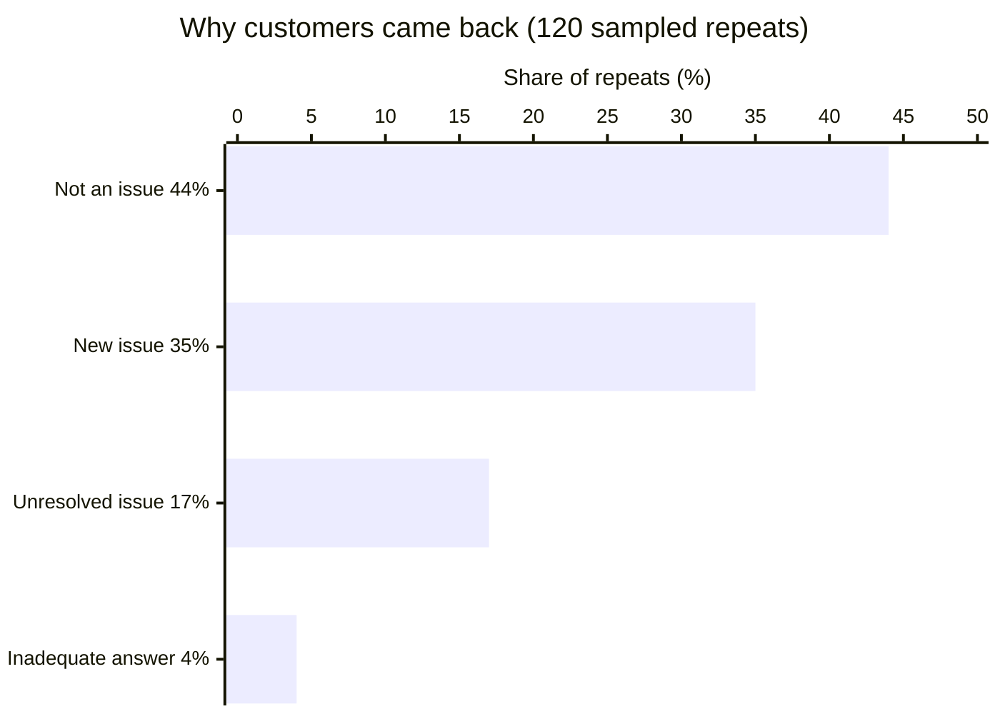
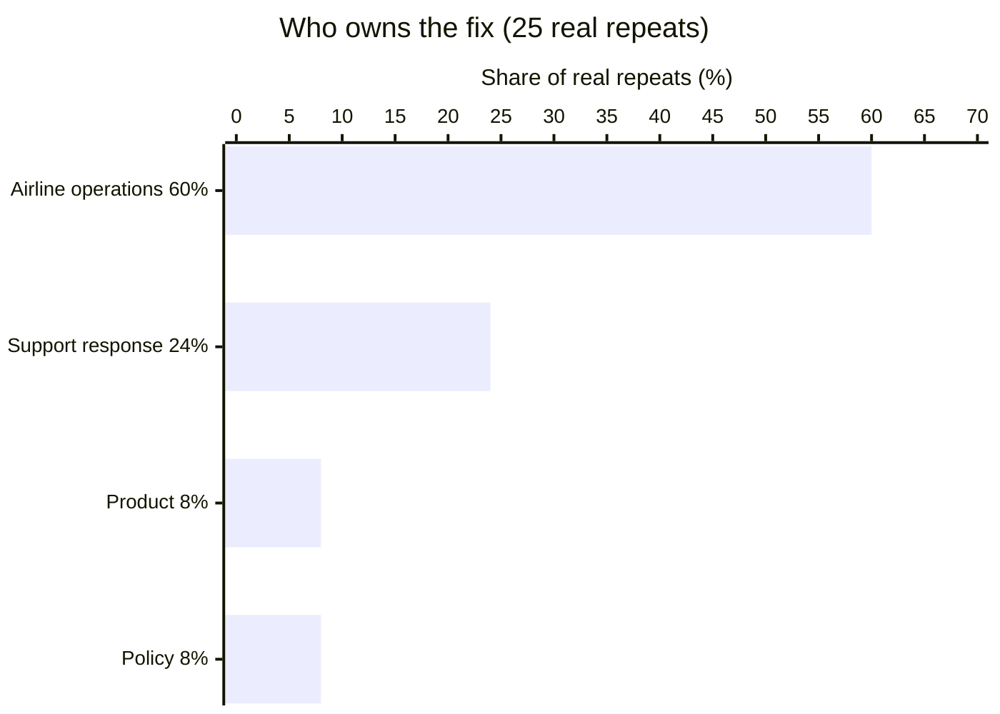

# Why Customers Contact Support Again: AI-Assisted Repeat-Contact Analysis

A prototype that finds repeat customer contacts in public airline support
data, uses AI to classify why each customer came back and who owns the fix,
and measures how accurate the AI's labels are against human review.

## Data at a glance

**Source:** Kaggle "Customer Support on Twitter": public tweets between
customers and company support accounts.
**Time period:** October 1 to December 3, 2017 (first contacts counted
through November 26, so each had a full 7-day follow-up window).
**Airlines (9):** Delta, American, British Airways, Southwest, AirAsia,
JetBlue, Alaska, Virgin Atlantic, Virgin America.

| Stage | Count |
|---|---|
| All tweets in dataset | 2,811,774 |
| Airline support tweets | 361,785 |
| Conversations (reply threads) | 113,891 |
| Eligible first contacts | 97,327 |
| Repeat contacts (1 hour to 7 days later) | 8,475 (8.7%) |
| Random sample labeled by AI | 120 pairs |
| Hand-labeled for accuracy check | 30 pairs |

**Repeat contact:** the same customer contacting the same airline again,
in a new conversation, 1 hour to 7 days after their first contact.

## Key findings

- **8.7%** of customer conversations were followed by another contact
  with the same airline within 7 days.
- **79% of those weren't real repeats.** Most were praise or unrelated
  new questions. Only about **21%** were customers returning because of
  an actual problem, so the true repeat rate was roughly **1–2.5%**.
- **Operations drove most real repeats** (60%): ongoing delays,
  cancellations, lost bags. Support-response issues were 24%.
- **AI labels matched human review 76.7%** of the time blind, and
  **96.7%** were judged acceptable after reviewing disagreements.





<details>
<summary>Show exact numbers</summary>

| Why the customer came back | Share of repeats |
|---|---|
| Not an issue (praise, chatter) | 44% |
| New, unrelated issue | 35% |
| Problem not resolved | 17% |
| Inadequate answer | 4% |

| Who owns the fix (real repeats only) | Share |
|---|---|
| Airline operations | 60% |
| Support response | 24% |
| Product (website/app) | 8% |
| Policy | 8% |

</details>

## Approach

1. **Data:** Kaggle "Customer Support on Twitter" (2.8M tweets, 2017),
   filtered to 9 airlines (~362K tweets).
2. **Conversations:** rebuilt reply threads into ~113K conversations.
3. **Repeat contacts:** same customer + same airline, new conversation
   1 hour to 7 days after the first. First contacts limited to Oct 1 to
   Nov 26 so every contact had a full 7-day follow-up window.
4. **Data checks:** spot-checks showed returns within 1 hour were the
   same conversation split across threads, and ~3% of threads mixed
   multiple customers; both were excluded.
5. **AI tagging:** a random sample of 120 repeat pairs, labeled by
   Claude (Sonnet 5) using a written labeling guide.
6. **Accuracy check:** 30 pairs hand-labeled blind and compared
   with the AI's labels; every disagreement was reviewed.

## Limitations

- Twitter is a proxy for support channels. Calls, emails and DMs aren't visible.
- Opening tweets that never got an airline reply aren't captured.
- Results come from a 120-pair sample; percentages are approximate.

## Repo guide

| Path | What it is |
|---|---|
| [`sql/`](sql/) | Pipeline: build tables, find repeats, sample, compare labels (files 01–08) |
| [`sql/checks.sql`](sql/checks.sql) | Every validation check, its result, and decisions made |
| [`labeling_guide.md`](labeling_guide.md) | Label definitions used by both AI and human |
| [`prompts/tagging_prompt.md`](prompts/tagging_prompt.md) | Exact AI prompt and run notes |
| [`evaluation_plan.md`](evaluation_plan.md) | How accuracy was measured, and results |
| [`production_design.md`](production_design.md) | Production design, measurement plan, safeguards |
| [`labels/`](labels/) | AI labels, human labels, disagreement review |

## Repo guide

| Path | What it is |
|---|---|
| `sql/01–08_*.sql` | Pipeline: build tables, find repeats, sample, compare labels |
| `sql/checks.sql` | Every validation check, its result, and decisions made |
| `labeling_guide.md` | Label definitions used by both AI and human |
| `prompts/tagging_prompt.md` | Exact AI prompt and run notes |
| `evaluation_plan.md` | How accuracy was measured, and results |
| `production_design.md` | Production design, measurement plan, safeguards |
| `labels/` | AI labels, human labels, disagreement review |

## Reproduce

Requires a Kaggle account and the `kaggle` and `sqlite3` command-line tools.

```
kaggle datasets download thoughtvector/customer-support-on-twitter -p data --unzip
sqlite3 data/twcs.db ".import --csv data/twcs/twcs.csv tweets"
sqlite3 data/twcs.db < sql/01_airline_tweets.sql
# ...then run sql/02 through sql/04 in order
```
Note: `06_sample_pairs.sql` draws a random sample, so a rerun gives
different pairs from the ones labeled here.

## How this was built

Built in GitHub Codespaces with SQLite, with Claude as an AI assistant
for writing SQL and for labeling. Analysis decisions, the labeling guide,
hand labels and disagreement review are my own.